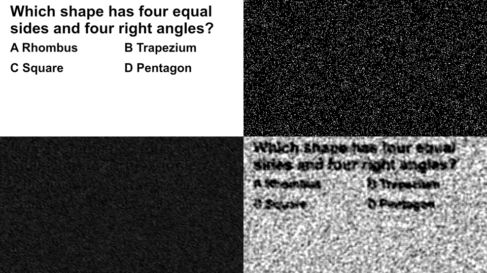

# 02 · Motion-defined text: a defense, then an adaptive attack

*Measured 9 October 2026, offline prototype (never deployed). Mehmet Tokgöz, Abrakadabra Games.*

## The question

Note 01 showed that text, canvas and image questions are all readable by a model. Live-streaming the question as video (for example with AWS IVS) only changes what the bot screenshots. Could we show a question that **no single frame contains**?

## The defense

Our defense is a random-dot kinematogram, a classic vision-science stimulus.

- **Server side:** the server renders the question card to a private glyph mask (480 × 270 cells). The text never leaves the server.
- **Dot field:** 12,000 short-lived dots fill the card.
  - Dots born *inside* the glyphs move one way along a random axis.
  - Dots born *outside* move the opposite way.
  - 10% of dots move randomly and carry no information.
- **Per-player variation:** axis and speed are seeded per player and per question.
- **What goes over the wire:** one occupancy bitmap per frame, 20 fps over a WebSocket. There are no dot ids, no velocities and no text.
- **What a single frame shows:** a uniform field of dots. The words exist only as **coherent motion between frames**.

Cost: about 1.4 Mbps per active player, and one CPU core serves about 40 streams. That is roughly a tenth of the cost of per-player IVS streaming.

## Attack 1: a vision model sees pixels

n = 40 questions per mode, options shuffled. Chance is 25%; both models mostly answered "B" on noise, which scores 27.5% here.

| What the model saw | Haiku 5.5 | Sonnet 5.5 |
|---|---|---|
| Control: same card as a clean static image | **92.5%** | **100%** |
| Single canvas frame | 30% | 30% |
| Mean of 5 frames | 32.5% | – |
| Mean of 30 frames | 37.5% | 30% |
| Max-projection of 30 frames | 22.5% | – |

**At the pixel level it is at chance for both models, in every capture mode we tried.** An OCR probe recovered 0 of the question words.

## Attack 2: the adaptive attacker

Any defense that is only tested against the attacks it was designed for is not tested. So we wrote the obvious counter in one sitting: **a ~90-line decoder** with no libraries.

1. It reads the WebSocket directly.
2. It cross-correlates consecutive bitmaps to find the two dominant displacements, without being told the axis or speed.
3. It marks dots that reappear at either displacement and sums over K frame pairs.
4. It renders a dark-on-white image and hands that to the model.

| Frames integrated | Stream time | Mask recovery (AUC) | Haiku 5.5 | Sonnet 5.5 |
|---|---|---|---|---|
| 8 | 0.4 s | 0.88 | 25% | – |
| 16 | 0.8 s | 0.94 | 7.5% | 20% |
| **40** | **2.0 s** | **0.97** | 15% | **47.5%** (about 59% if refusals become random guesses) |

*Top left: the clean card (models read it 92.5–100% of the time). Top right: one streamed frame. Bottom left: the mean of 30 frames, both at chance. Bottom right: our decoder after 40 frames (2 s).*

At 40 frames the decoded question is legible to a person. Sonnet 5.5 read it about half the time; Haiku mostly refused. A better decoder (matched filters, dot tracking, OCR tuned to the stroke width) would probably raise this. **We don't know the ceiling.**

## What it costs the attacker

| | Plain text API (today) | Motion text vs. integrating bot |
|---|---|---|
| Earliest answer | 0.65 s | about 3.3 s (+2.6 s) |
| Build effort | none | days for a first decoder |
| Cost per question | $0.0001 | about $0.003 (needs a stronger vision model) |

It does **not** cost the attacker points. Our reading window (median 3.2 s) still covers a 3.3 s bot. Shortening the window would hurt people too, and nobody has measured how fast people read this stimulus.

## Honest conclusion

- **Not "bot-proof".** Against screenshot bots it holds: chance in every mode for both models. Against a bot built for it, it becomes "expensive and slower".
- **Human readability is untested.** We ran no human trial. Reading time, error rate, fatigue and phone performance all decide viability, so this comes first before any product decision.
- **Accessibility is poor.** People with motion-perception deficits, low vision or reduced-motion settings would be excluded, so any use would need an accessible route. That is why it stayed a prototype.

## Takeaways

1. **Always run the adaptive attack yourself.** The pixel-level result alone would have been a misleading headline.
2. Static evals overstate robustness. **Integration over time** is a general route around any defense that hides information in temporal structure.
3. The defender can change axis, speed and dot life per question, or add contrast reversal between frames. Each of these forces re-engineering, but also raises the cost for humans by an unknown amount. Measuring that trade-off for humans and models together is the interesting research problem.

## Reproduce

The prototype, decoder and red-team runner are in [`code/motion-text/`](code/motion-text/). It runs locally with Node 22. Model calls need your own Bedrock API key.
